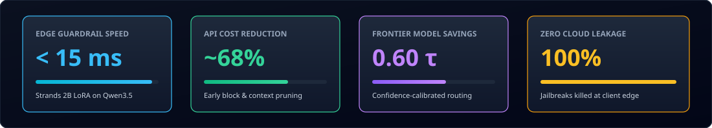

Polyglot Edge Agent

Gemini-powered AI proxy with API-key authentication, readiness checks, and optional Supabase-backed authentication.

Overview · Architecture · Quick Start · API · Deployment

Overview

Polyglot Edge Agent is a FastAPI-based proxy for AI inference. It provides an API boundary for clients, validates API access, checks service readiness, and connects requests to the configured Gemini provider. Supabase PostgreSQL can be used for database-backed API-key authentication and related records.

Provider status: Gemini is the active provider. AWS Bedrock code in backend/api.py is commented legacy reference code only; it is not imported, initialized, or called.

Architecture

<strong>Expand the text architecture diagram</strong>

flowchart TD
    C["Client / Browser Extension"] --> API["FastAPI application"]
    API --> AUTH["API-key / Bearer authentication"]
    AUTH --> GUARD["Request validation and safety checks"]
    GUARD --> PROXY["Proxy request handling"]
    PROXY --> GEM["Google Gemini API"]
    API -. optional database-backed auth .-> DB[("Supabase PostgreSQL")]
    DB --- U["users"]
    DB --- K["api_keys"]
    DB --- L["usage_logs"]
    API --> H["/health"]
    API --> R["/ready"]

This is a high-level overview. Check the implementation in backend/ for the exact request flow.

Request workflow

Client sends a request to the FastAPI endpoint.

Authentication is checked according to the environment configuration.

Backend request handling and guardrails run.

The configured Gemini model is invoked.

The API returns the response and sanitizes provider errors.

/ready checks Gemini readiness separately; /health only reports process availability.

Stack

Component

Purpose

Python + FastAPI

HTTP API application

Google Gemini

Active inference provider

Supabase PostgreSQL

Optional database-backed API-key authentication and related records

Docker

Containerized execution

Pytest

Backend tests

Browser extension

Client-side integration in extension/

Quick Start

1. Clone the repository

git clone https://github.com/<YOUR-USERNAME>/polyglot-edge-agent.git
cd polyglot-edge-agent

2. Create an environment and install dependencies

python -m venv .venv
.\.venv\Scripts\python.exe -m pip install --upgrade pip
.\.venv\Scripts\python.exe -m pip install -r requirements.txt

3. Configure environment variables

Copy-Item .env.example .env

Edit .env locally and configure the variables required by your setup, including GEMINI_API_KEY and GEMINI_MODEL. Set DATABASE_URL if you want database-backed authentication.

Never commit .env or put real secrets in source code, README examples, screenshots, or logs. In production, use your deployment platform's secret manager.

4. Start the API

.\.venv\Scripts\python.exe -m uvicorn backend.api:app --host 127.0.0.1 --port 8000

Local endpoints:

Endpoint

Purpose

/health

Reports process availability only

/ready

Performs a bounded Gemini verification and caches its result

/docs

Interactive Swagger docs, if enabled

/openapi.json

OpenAPI schema, if enabled

Use 127.0.0.1 for local-only access. Containers and hosting platforms may require a different host/port.

Authentication and API keys

POST /v1/proxy/chat requires X-API-Key or a bearer token when POLYGLOT_API_KEY is configured, and always requires authentication when POLYGLOT_ENV=production.

Local fallback

Without DATABASE_URL, local development can use the configured POLYGLOT_API_KEY fallback.

Supabase-backed authentication

When DATABASE_URL is configured, the API hashes the submitted API key with SHA-256 and matches it against an active api_keys row. The raw key is displayed once during provisioning; only its hash is stored.

Provision a key interactively:

.\.venv\Scripts\python.exe -m backend.provision_api_key

For a non-interactive shell, set POLYGLOT_PROVISION_EMAIL before running the command.

Database URL tip: URL-encode special characters in database passwords. For example, # becomes %23. Keep the connection string in a secret store, not in Git.

API Reference

GET /health

A process-health endpoint. A successful response does not prove Gemini credentials, model access, or inference are working.

GET /ready

Checks Gemini configuration and performs one bounded Gemini verification. Results are cached for POLYGLOT_READINESS_CACHE_SECONDS (default 300 seconds). Errors are sanitized when Gemini is unavailable.

POST /v1/proxy/chat

Submits an inference request. Authentication requirements depend on the configuration above. Use the running service's /docs or /openapi.json for the exact request/response schema; those are the source of truth.

Example HTTP header shape:

POST /v1/proxy/chat
Content-Type: application/json
X-API-Key: YOUR_API_KEY

Never place a real key in a public example or browser-side code.

Deployment

Docker

Run from the project root:

docker build -t polyglot-edge-agent .
docker run --rm -p 8000:8000 --env-file .env polyglot-edge-agent

Supply GEMINI_API_KEY through the deployment platform's secret manager. Configure DATABASE_URL there too if using Supabase authentication.

Production checklist

Set GEMINI_API_KEY as a secret.

Set GEMINI_MODEL to a model available to your API key.

Set POLYGLOT_ENV=production.

Configure DATABASE_URL if using Supabase-backed authentication.

Review POLYGLOT_READINESS_CACHE_SECONDS.

Verify the hosting start command and port.

Test /health, /ready, and an authenticated inference request.

Ensure .env, .venv, credentials, model weights, caches, and local artifacts are excluded from Git and Docker images.

Review render.yaml before deploying to Render.

Security notes

Never commit .env, API keys, AWS credentials, database passwords, or tokens.

Keep .env.example restricted to placeholder values.

Rotate any credential that was accidentally exposed.

Use HTTPS for hosted deployments.

Use high-entropy API keys and separate credentials for each environment.

Review Git history if a secret was committed; deleting it from the latest version does not remove it from earlier commits.

Do not treat /health as an inference test.

Repository structure

polyglot-edge-agent/
├── assets/
│   ├── hero-banner.svg
│   ├── performance-stats.svg
│   ├── Polyglot Edge Agent System Architecture.png
│   └── workflow-pipeline.svg
├── backend/                 # FastAPI app and backend modules
├── extension/               # Browser extension
├── .dockerignore
├── .env.example             # Template only; no real secrets
├── .gitignore
├── Dockerfile
├── README.md
├── render.yaml
└── requirements.txt

This map highlights the main project components; other development folders may exist locally.

Testing

Run backend tests from the repository root:

.\.venv\Scripts\python.exe -m pytest backend -v

Review test results before deployment; they can change as the code and environment change.

Roadmap

FastAPI proxy foundation

Gemini provider integration

API-key authentication options

Cached readiness verification

Docker and Render configuration files

Add or maintain automated CI checks

Expand provider-independent routing and observability

Publish versioned releases and deployment examples

Items marked as planned are suggestions, not claims that they are already implemented.

Contributing

Fork the repository.

Create a focused feature branch.

Add or update tests.

Run the test suite.

Open a pull request describing the change and validation.

Do not include credentials, private database URLs, or real user data in contributions.

License

No license is specified here. Add a LICENSE file before describing the project as open source or granting reuse permissions.

Built to make AI inference easier to integrate, test, and deploy.

The source code and live OpenAPI schema take precedence over this README.

