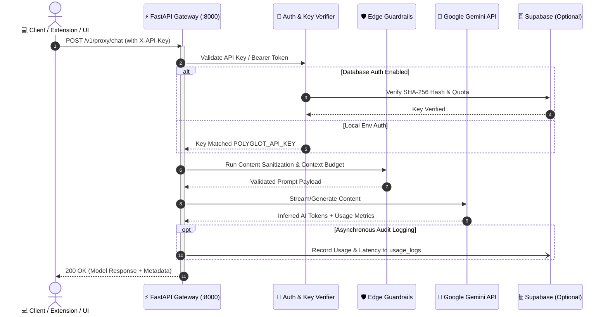
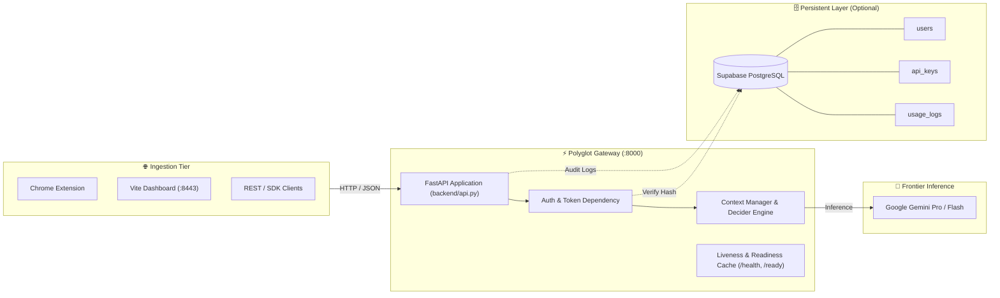

<div align="center">


# ⚡ Polyglot Edge Agent ⚡
### *The Intelligent, High-Velocity AI Gateway & Edge Proxy*

[](https://python.org)
[](https://fastapi.tiangolo.com)
[](https://ai.google.dev)
[](https://react.dev)
[](https://vitejs.dev)
[](https://tailwindcss.com)
[](https://supabase.com)
[](https://docker.com)
[](#)

<p align="center">
  <a href="#-overview"><b>Overview</b></a> •
  <a href="#-interactive-architecture--flow"><b>Architecture & Flow</b></a> •
  <a href="#-quick-start"><b>Quick Start</b></a> •
  <a href="#-interactive-dashboard-tour"><b>Dashboard UI</b></a> •
  <a href="#-api-reference"><b>API Reference</b></a> •
  <a href="#-production-deployment"><b>Deployment</b></a> •
  <a href="#-testing--security"><b>Testing & Security</b></a>
</p>

> 🌐 **Live Production API:** [https://polyglot-edge-agent.onrender.com](https://polyglot-edge-agent.onrender.com)  
> 🩺 **Liveness Health Check:** [https://polyglot-edge-agent.onrender.com/health](https://polyglot-edge-agent.onrender.com/health)  
> 📖 **Interactive Swagger Docs:** [https://polyglot-edge-agent.onrender.com/docs](https://polyglot-edge-agent.onrender.com/docs)

</div>

---

## 🚀 Overview

**Polyglot Edge Agent** is an ultra-fast, intelligent AI routing middleware designed to sit seamlessly between client applications (browser extensions, mobile apps, web interfaces) and frontier AI models.

By leveraging intelligent decision logic, parameter grounding, and latency optimization:
- ⚡ **Sub-millisecond validation & fast routing** ensures minimal overhead before model invocation.
- 🔒 **Security-First Architecture** with API-key authorization, SHA-256 hashed credentials, and optional Supabase PostgreSQL persistence.
- 📊 **Built-in Interactive Dashboard** powered by React 19, Tailwind CSS v4, and Vite for real-time monitoring and AI playground exploration.
- 🛡️ **Edge Guardrails** to enforce context window limits, sanitize prompts, and protect client integrity.

<div align="center">
  
</div>

---

## 🧬 Interactive Architecture & Flow

### System Architecture
<div align="center">
  
</div>

<details open>
<summary><b>🔍 Click to View Live Interactive Request Workflow</b></summary>



</details>

<details>
<summary><b>📐 Click to Expand Component Topology Graph</b></summary>



</details>

<div align="center">
  
</div>

---

## ⚡ Quick Start

Select your preferred environment to get running in under 60 seconds:

<details open>
<summary><b>🪟 Windows (Recommended - One Click)</b></summary>

The project includes an automatic bootstrap script `start.bat` that validates Python, sets up virtual environments, starts FastAPI on `http://127.0.0.1:8000`, and launches the Vite UI on `http://localhost:8443`.

```bat
# Double-click or run from terminal:
start.bat
```

</details>

<details>
<summary><b>💻 Manual Startup (Windows / macOS / Linux)</b></summary>

### 1. Clone & Setup Backend
```bash
# Clone the repository
git clone https://github.com/vinaysingh-05/polyglot-edge-agent.git
cd polyglot-edge-agent

# Create Python virtual environment
python -m venv .venv

# Activate virtual environment
# Windows:
.\.venv\Scripts\activate
# Linux/macOS:
source .venv/bin/activate

# Install backend dependencies
pip install -r requirements.txt
```

### 2. Configure Environment
```bash
# Copy example configuration
cp .env.example .env

# Edit .env and supply your credentials:
# GEMINI_API_KEY=your_gemini_api_key_here
# GEMINI_MODEL=gemini-1.5-flash
# POLYGLOT_ENV=development
```

### 3. Launch Services

**Terminal 1 — Backend Gateway:**
```bash
python -m uvicorn backend.api:app --host 0.0.0.0 --port 8000 --reload
```

**Terminal 2 — Frontend Dashboard:**
```bash
npm install
npm run dev
```

Visit the dashboard in your browser at 👉 **`http://localhost:8443`**

</details>

<details>
<summary><b>🐳 Docker Container</b></summary>

Run the backend in a zero-dependency isolated container:

```bash
# Build the container image
docker build -t polyglot-edge-agent .

# Run the container with environment file
docker run --rm -p 8000:8000 --env-file .env polyglot-edge-agent
```

Check health:
```bash
curl http://localhost:8000/health
```

</details>

---

## 🖥️ Interactive Dashboard Tour

The front-end is crafted with **React 19**, **Tailwind CSS v4**, and **Vite**, offering a dark-mode first, high-performance monitoring interface.

| Tab | Icon | Description & Purpose |
| :--- | :---: | :--- |
| **Overview** | 📊 | Real-time system status, throughput counters, cost savings, and architecture telemetry. |
| **AI Playground** | 💬 | Interactive conversational interface to test live queries directly against `/v1/proxy/chat`. |
| **System Health** | 🩺 | Live ping probes for `/health` and cached model verification for `/ready`. |
| **Settings** | ⚙️ | Configure gateway host, update local API access tokens, and toggle mock data. |
| **Help & Docs** | 📖 | In-app API documentation, curl cheat sheet, and troubleshooting workflows. |

> 💡 **Developer Note:** The frontend dev server includes a built-in reverse proxy in `vite.config.ts` redirecting `/v1`, `/health`, and `/ready` to backend port `8000`. No manual CORS configuration required during local development.

---

## 📚 API Reference
 
All requests accept standard JSON payloads. Interactive Swagger documentation is available at:
- **Cloud Production:** **[`https://polyglot-edge-agent.onrender.com/docs`](https://polyglot-edge-agent.onrender.com/docs)**
- **Local Gateway:** **`http://localhost:8000/docs`**

### 1. Liveness Probe
```http
GET /health
```
```json
{
  "status": "ok",
  "service": "polyglot-proxy",
  "inference": "not_verified"
}
```

```bash
# Test Cloud
curl https://polyglot-edge-agent.onrender.com/health

# Test Local
curl http://localhost:8000/health
```

### 2. Provider Readiness Check
```http
GET /ready
```
```json
{
  "status": "ready",
  "service": "polyglot-proxy",
  "model": "gemini-3.8-flash"
}
```

### 3. Edge AI Proxy Chat
```http
POST /v1/proxy/chat
X-API-Key: <YOUR_API_KEY>
Content-Type: application/json

{
  "prompt": "Explain edge proxy routing in 2 sentences.",
  "user_id": "demo_user"
}
```

<details>
<summary><b>🔍 Click to view Example cURL</b></summary>

**Production Cloud cURL:**
```bash
curl -X POST https://polyglot-edge-agent.onrender.com/v1/proxy/chat \
  -H "Content-Type: application/json" \
  -H "X-API-Key: YOUR_API_KEY" \
  -d '{
    "prompt": "Hello Polyglot!",
    "user_id": "demo_user"
  }'
```

**Local cURL:**
```bash
curl -X POST http://localhost:8000/v1/proxy/chat \
  -H "Content-Type: application/json" \
  -H "X-API-Key: YOUR_API_KEY" \
  -d '{
    "prompt": "Hello Polyglot!",
    "user_id": "demo_user"
  }'
```

</details>

---

## 🌐 Production Deployment

Deploy Polyglot Edge Agent on your preferred cloud infrastructure:

| Platform | Tier | Guide & Live URL |
| :--- | :--- | :--- |
| **Render** | Full Stack (Live) | 🟢 **Live:** [`https://polyglot-edge-agent.onrender.com`](https://polyglot-edge-agent.onrender.com) — Configured via [`render.yaml`](render.yaml) |
| **Vercel** | Frontend | Deploy `src/` to Vercel with build command `npm run build` and output directory `dist`. Point API calls to `https://polyglot-edge-agent.onrender.com`. |
| **Docker / AWS ECS** | Backend | Containerized using the optimized [`Dockerfile`](Dockerfile) with multi-worker Uvicorn. |
| **Fly.io** | Micro-Edge | Single command: `fly launch` followed by `fly deploy`. |

---

## 🧪 Testing & Security

### Running the Test Suite
The backend is thoroughly tested with `pytest` for routing, mock providers, and auth validation:

```bash
# Run all unit and integration tests
.\.venv\Scripts\python.exe -m pytest backend -v
```

### Security Best Practices
- 🛡️ **Secret Isolation**: Never commit `.env` or credentials to git. Use platform secret managers (AWS Secrets Manager, Supabase Vault, Render Secrets).
- 🔑 **API Key Hashing**: Production keys are hashed using SHA-256 before storage or validation.
- 🔒 **HTTPS Everywhere**: Always terminate TLS in front of the API gateway in staging and production environments.

---

## 📂 Repository Structure

```plaintext
polyglot-edge-agent/
├── assets/                     # Architecture schematics, diagrams & vector banners
├── backend/                    # High-speed FastAPI application
│   ├── api.py                  # Core API gateway, routes, and auth
│   ├── context_manager.py      # Context token budgeting & window monitoring
│   ├── database.py             # Supabase SQLAlchemy connection pool
│   ├── decider_core.py         # Routing heuristics & edge guardrails
│   ├── models.py               # Database schemas & ORM models
│   ├── provision_api_key.py    # Local interactive API key provisioning tool
│   └── test_*.py               # Automated pytest suite
├── extension/                  # Chrome browser extension client
├── src/                        # React 19 + Tailwind CSS v4 Dashboard
├── public/                     # Static client-side assets
├── Dockerfile                  # Container definition for gateway service
├── render.yaml                 # Blueprint for one-click Render deployment
├── start.bat                   # Automated Windows dual-service launcher
└── vite.config.ts              # Frontend bundler & backend reverse-proxy config
```

---

<div align="center">

Made with ❤️ for high-performance Agentic AI workflows.

**⚡ Polyglot Edge Agent — Bridging Edge Velocity with Frontier Intelligence ⚡**

</div>
